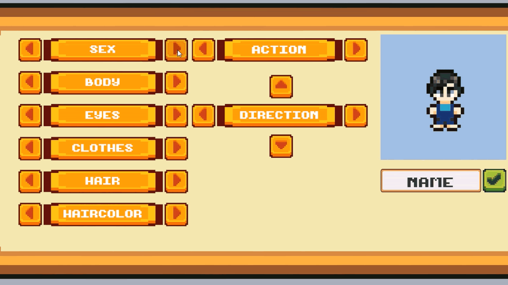
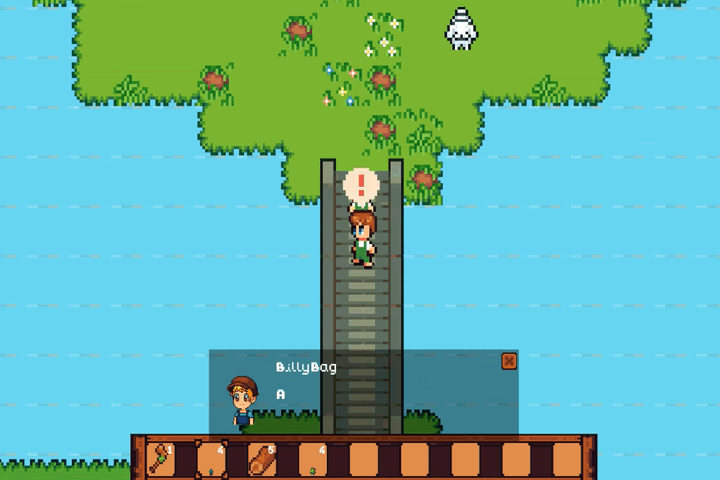
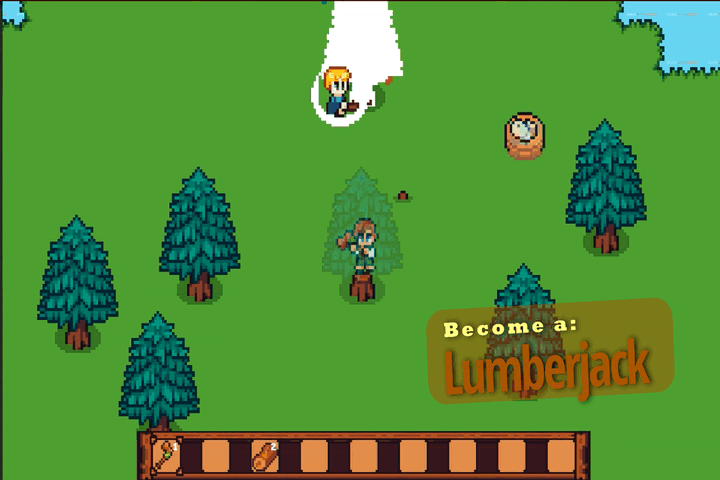

# Topdown Game
#### Created with Unity
#### Sprites made by Maeve Devs - [Itch.io page](https://maevedevs.itch.io/farm-rpg)

## Introduction

This is a hobby project serving two purposes. Learning more about scalable codebases and general entertainment. At this moment the project is still being worked on, the development focus therefore lies on building systems rather than content for the game.
There is a small playable demo available under Releases. That being said, here is some of the content actively being worked on:

## Character Customization
A fully customized Character customisation system that is tailor-made to suit spriteanimations. Unity's system does not allow for spriteswapping.

More customisation on the way! 

## Quests
A whole heap of questgivers available with many quest types. Not only do these help you get started, the grumps behind them might help you out in the future...

## Jobs
Various available activities for you to enjoy. A worker system is in the works. Helping people out might just let you recruit them to elevate your business.

## Roadmap
Where does this all lead? What is the point of it all? This is still being worked out, though there is definitely a plan behind the madness. These are some of the key things being worked on right now:
1. Worker system
    - NPCs are already able to perform small tasks. This will be vastly expanded so they can not just show you how to do things, but work autonomously under your command
2. Combat
    - Although the aim is not to make this a survival/hardcore type game, there will be some forces trying to mess with your coziness throughout the journey. Don't worry though, with the right companions (humans or otherwise) and some planning, the comfort of your home shall prevail.
3. Buildings and workshops
   - Expand your home with decorations, stables, farmhouses, bakeries, blacksmiths, windmills, ...
   - There will be more. 
4. Evil
   - Something will be lurking in the niceness of your greenery, be aware...